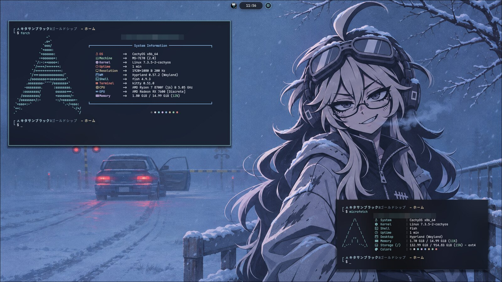
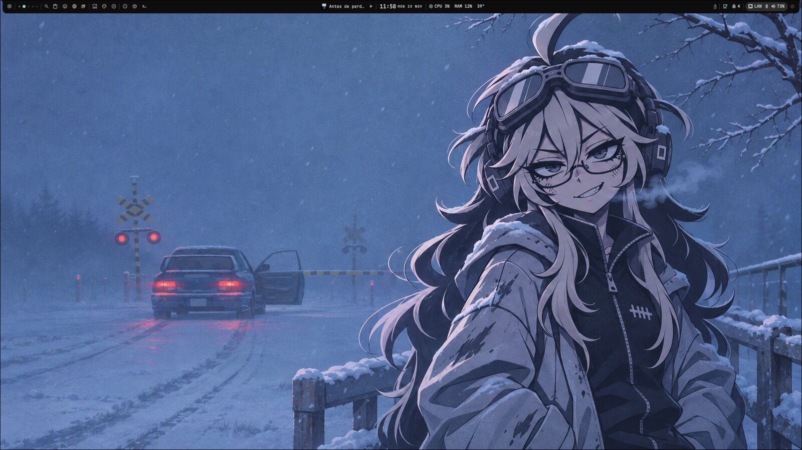
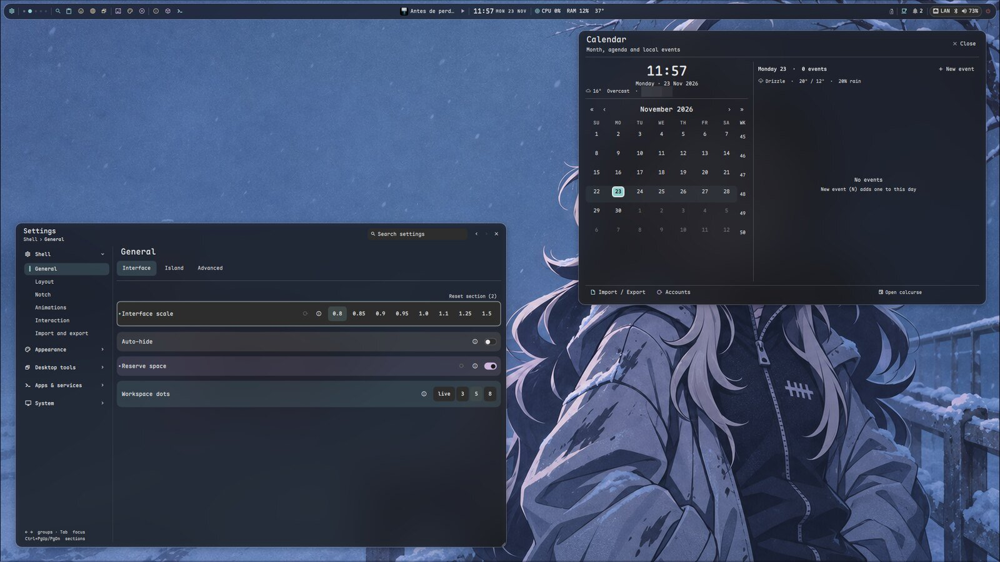
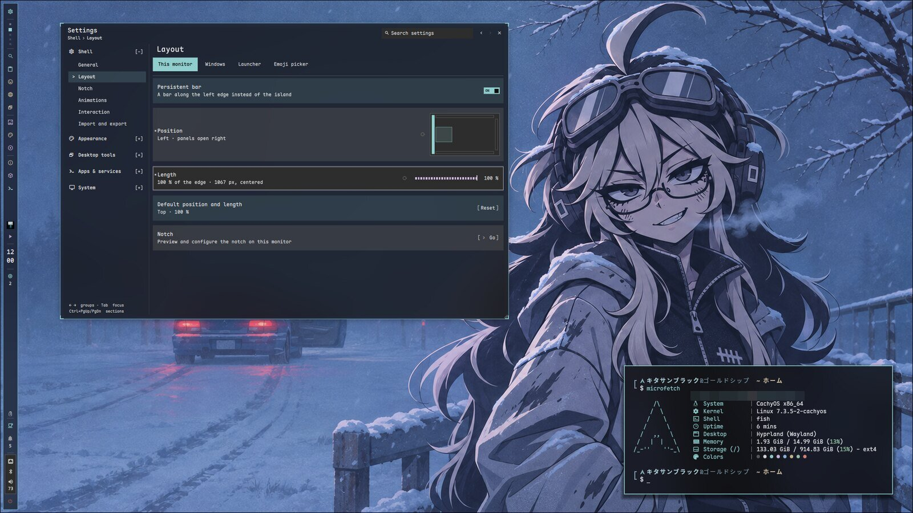

# Sumi Shell

A desktop shell for **Hyprland**, written in Quickshell (Qt 6 / QML). One process gives each monitor a presentation:
**Dynamic Capsule**, **Dynamic Bar**, **Edge** or **Bar-Edge**, and the launcher, dashboard, control center, mixer,
calendar, settings, system monitor, wallpaper browser and session lock that open from it.

<p align="center">
  
</p>

**Status:** Application version: **0.4.0**. Public API: **1** ([`sumi/version.json`](sumi/version.json)). There is no
release tag and no published package yet: you install from a clone. Version 0.4.0 passed a
[portability acceptance run on clean Arch Linux VMs](docs/PORTABILITY-ACCEPTANCE.md), within the limits that report
states. 

>Important: This shell is currently in beta. Full compatibility across all PCs is not guaranteed. (╥﹏╥)

## Gallery

| | |
| --- | --- |
| <br>**Edge** | <br>**Bar-Edge** |
| <br>**Dynamic Bar** with Settings and Calendar (Soft) | <br>**Dynamic Bar on the left edge** (Terminal style) |

## Presentations and styles

| Presentation | What it is |
| --- | --- |
| **Dynamic Capsule** | The default for a new monitor. A compact capsule with the clock and live activity that grows into panels. |
| **Dynamic Bar** | A bar with desktop tools and system status. Its edge and length are set per monitor. |
| **Edge** | Replaces the floating capsule with a shape joined to the top edge of the screen, like a notch. It keeps the same panels and shows configurable live activities (music, recording and others) beside it. |
| **Bar-Edge** | **Dynamic Bar** and **Enable Edge** turned on together: the bar joins the top edge and takes the Edge outline. |

Presentation and Edge preferences are stored per monitor, in **Settings → Shell → Layout** and its **Edge** page.
Configuration keys, IPC values and shortcut names keep their original identifiers (`island`, `bar`, `dock`, `notch…`),
so existing settings and scripts keep working. The **interface style** is chosen in
**Settings → Appearance → Interface style**. **Soft** uses rounded panels, capsules and an accent veil. **Terminal** uses
square frames, text-mode controls and monospace text. Its frame, decorations, monospace text and optional effects
(interference, scanlines and glow, off by default) are adjustable. Palette, material (Glass or Vidrio Satinado),
typography and motion are separate settings.

## Requirements

Sumi Shell runs inside a **Hyprland** Wayland session. The installer reports what is missing, but it never installs
packages. Package names are those of the tested Arch-family recipe.

| Core | Notes / Arch packages |
| --- | --- |
| Hyprland | `hyprland`. Hyprland 0.57 and later use a Lua configuration. A hyprlang fragment is kept for 0.56 and earlier. |
| Quickshell **0.3.1 or newer** with the modules Sumi imports | `quickshell`. Needs Hyprland, Wayland, Io, Widgets, Networking, Bluetooth, PipeWire, UPower, MPRIS, SystemTray, Notifications, Polkit and PAM. A version number alone does not prove these are built in. |
| Qt 6 with Qt Quick and the Wayland platform | `qt6-declarative`, `qt6-wayland` |
| Python **3.11 or newer** | `python`. Helpers use `tomllib`. |
| A D-Bus session bus | `dbus` |
| Bash and GNU tools | `bash`, `coreutils`, `findutils`, `procps-ng`, `util-linux`, `sed`, `grep` |
| Audio | `pipewire`, `wireplumber` (the tested stack) |
| Fonts | `fontconfig`; the default UI font is `ttf-iosevkaterm-nerd`, with fallbacks |
| Managed start only | A reachable `systemd --user`, logind and the graphical session's environment imported into it |

Optional features are detected at runtime. **Settings → System → Environment** shows what is available and why not.
Nothing needs editing in the QML.

| Feature | Optional dependencies |
| --- | --- |
| Idle locking and lock fallback | `hypridle`, `hyprlock`, a working PAM stack |
| Network and Bluetooth controls | `networkmanager`, `libnm`, `python-gobject` / `bluez` |
| Battery and power profiles | `upower`, `power-profiles-daemon` or a compatible service |
| Dynamic palette | `matugen` (static palettes work without it) |
| Wallpapers | `hyprpaper`, `awww`/`swww`, `mpvpaper` or your own script; `imagemagick` and `ffmpeg` for thumbnails; `qt6-multimedia` for video previews |
| Clipboard | `cliphist`, `wl-clipboard` |
| Calendar and media | `calcurse`, an MPRIS player; CalDAV needs `secret-tool` (`libsecret`) and a Secret Service |
| Screen recording and screenshots | `wf-recorder`, `ffmpeg`, `slurp`, `grim`; `pactl` for PulseAudio inputs |
| Live audio spectrum | `cava` |
| Automatic Lua integration | `luac` matching Hyprland's Lua version, `readelf` (`binutils`). The manual fragment does not need them. |
| Login screen management | Sumi SDDM with CLI API 1, a separate project |
| External monitor brightness | `ddcutil` with device access |
| Update checks | `pacman-contrib`, `fakeroot`, optionally yay/paru, or a provider script; `sysupdate` (optional) adds the risk check and Safe upgrade |
| Typography and other apps' themes | `python-fonttools` for font diagnostics, `python-cbor2` for Qt 5 plugin metadata, GSettings schemas for GTK, `xsettingsd` for the optional X11 transport |

Notifications and the Polkit agent are **off by default**. Turn them on only if no other notification daemon or agent is
running.

## Install

Run these from the root of a clone, inside an **unlocked** Hyprland session. Pick **one** way to start the shell and keep
**one** copy installed. Use the same flags for `check`, the dry run and the install.

```sh
git clone https://github.com/kitasael-burakku/Sumi-Shell.git
cd Sumi-Shell
```

### Direct start (no user service)

```sh
./install.sh check --install --no-units
./install.sh install --no-units --dry-run
./install.sh install --no-units
qs -c sumi --no-duplicate
```

This copies the shell to `~/.config/quickshell/sumi`. To start it with each session, add `qs -c sumi --no-duplicate` to
your Hyprland autostart. The [direct start guide](packaging/NO-SYSTEMD.md) covers that, the lock fallback without systemd
and systems with another login1 provider such as elogind (not part of the acceptance run).

### Managed start (systemd user service)

```sh
./install.sh check --install --enable
./install.sh install --enable --dry-run
./install.sh install --enable
```

`--enable` starts the shell with your **next** session. To start it now, first check that the user manager sees this
session:

```sh
systemctl --user is-active graphical-session.target
systemctl --user show-environment | grep -E '^(WAYLAND_DISPLAY|HYPRLAND_INSTANCE_SIGNATURE)='
systemctl --user start sumi-shell.service
```

Both variables must match the ones in your Hyprland session. A managed install also brings a systemd rescue for the
lock if the shell dies while locked.

### Local Arch package

```sh
python3 packaging/arch/build-local.py "$PWD" "$PWD" ../sumi-arch-build
```

This builds the `sumi-shell` and `sumi-shell-git` candidates locally. You install one with `pacman -U` and it runs from
`/etc/xdg/quickshell/sumi`. Only the stable candidate was installed and tested. **Stop the shell while unlocked before
upgrading or removing the package.** See the [build instructions](packaging/arch/README.md) and the
[package guide](packaging/arch/ARCH.md). Do not mix a package with a user installation.

### Check that it runs

```sh
./install.sh status              # user installation
qs -c sumi ipc call sumi api     # {"apiVersion":1,"version":"0.4.0","build":"sha256:…"}
```

`qs ipc call` exits with 0 even when a verb answers `false`, so read the output. A development checkout reports an
empty `build`.

### Going further

| Topic | Guide |
| --- | --- |
| Shortcuts and lock options in your Hyprland config (`./install.sh hyprland`) | [Installation guide → Hyprland](packaging/INSTALL.md#hyprland-the-shortcuts-and-the-lock-options) |
| Locking from hypridle (`./install.sh hypridle`) | [Installation guide → hypridle](packaging/INSTALL.md#hypridle-locking-with-the-shell) |
| Your palette in kitty, GTK, Qt and the Hyprland border (`./install.sh theme-apps`) | [Installation guide → theme-apps](packaging/INSTALL.md#theme-apps-the-shells-colours-in-other-apps) |
| Updating, `recover` and rollback | [Installation guide → Updating](packaging/INSTALL.md#updating) |
| Uninstalling and `--purge` | [Installation guide → Uninstall](packaging/INSTALL.md#uninstall) |
| Explicit migrations, coming from Kitasan-Shell | [Migrating legacy state](packaging/INSTALL.md#migrating-legacy-state), [Coming from Kitasan-Shell](packaging/INSTALL.md#coming-from-kitasan-shell) |
| What `check` looks at | [`install.sh check`](packaging/CHECK.md) |
| GTK 3 / X11 theme transport | [XSettings](sumi/docs/XSETTINGS.md) |

### Keyboard shortcuts

The shell registers 32 global shortcuts that you bind in Hyprland as `sumi:<name>`. Their default keys are in
[API.md](API.md#default-keys), and `./install.sh hyprland` and the
[examples](sumi/examples/hyprland/) use them. **Super+F1** opens a read-only window with each action and the key your
Hyprland gives it. With a Lua config, that window can only recognise a binding that carries the description
`Sumi Shell: <name>`:

```lua
hl.bind("SUPER + SPACE", hl.dsp.global("sumi:launcher"), { description = "Sumi Shell: launcher" })
```

## Validation

The [acceptance report](docs/PORTABILITY-ACCEPTANCE.md) covers the 0.4.0 candidate (commit `14e07e8` of the history
before publication) on clean Arch Linux VMs (Hyprland 0.57.2, Quickshell 0.3.2, Qt 6.12, systemd 262.2, KVM with
VirGL, one virtual output). Direct and managed installs, persistence across sessions, surfaces and IPC, recovery from
a broken Qt backend and a truncated settings file, PAM authentication, lock rescue after a crash, hypridle, and
install, reinstall and removal of the stable package with pacman all passed: **25 PASS**. There was **1 diagnostic
FAIL**: the PAM failure counter in an autologin test bench, outside normal password login, where the counter was
verified. There was **1 SKIP**: no older package existed to upgrade from.

These results do not cover other compositors or distributions, physical hardware, suspend, other PAM configurations or
several monitors while locked. The installer and API suites in [`tests/`](tests/) run from a clone.

## Configuration and API

| Data | Default location |
| --- | --- |
| Settings, tasks, websites and providers | `~/.config/sumi-shell/` (`XDG_CONFIG_HOME`) |
| Palette, wallpaper and theme state, history, install manifest | `~/.local/state/sumi-shell/` (`XDG_STATE_HOME`) |
| Thumbnails and caches | Under `XDG_CACHE_HOME` |
| Installed user runtime | `~/.config/quickshell/sumi/` |

Your settings live apart from the code: updating or uninstalling keeps them. The [examples](sumi/examples/README.md)
cover tasks, websites, Hyprland and hypridle.

[API.md](API.md) is the public contract: 11 IPC verbs, 32 global shortcut names, and the `tasks.json` and
`providers.json` formats. [`api/contract-v1.json`](api/contract-v1.json) is its machine-readable form. Every other IPC
verb is internal and may change in any release. Changes are listed in [CHANGELOG.md](CHANGELOG.md), and versions follow
[Semantic Versioning](https://semver.org/spec/v2.0.0.html).

## Contributing

Issues and pull requests are welcome.

**Where things are**

| Path | What it holds |
| --- | --- |
| [`sumi/shell.qml`](sumi/shell.qml), [`sumi/core/`](sumi/core/) | Entry point, per-monitor composition, presentations and the IPC handler |
| [`sumi/surfaces/`](sumi/surfaces/) | Launcher, dashboard, Settings and the other panels and windows |
| [`sumi/services/`](sumi/services/), [`sumi/lib/`](sumi/lib/), [`sumi/scripts/`](sumi/scripts/) | State, capability detection and helpers |
| [`sumi/theme/`](sumi/theme/), [`sumi/lock/`](sumi/lock/) | Styles and appearance, the session lock |
| [`packaging/`](packaging/), [`install.sh`](install.sh) | Installer, checks, updates and the Arch recipes |
| [`tests/`](tests/) | API, installer, release and feature tests |

**Reporting a problem.** Include:

- the output of `./install.sh --version` and `qs -c sumi ipc call sumi api`;
- `./install.sh check --json`;
- your Hyprland and Quickshell versions and whether your config is Lua or hyprlang;
- what **Settings → System → Environment** says about the feature;
- the log, from `journalctl --user -u sumi-shell -n 100 --no-pager` or `qs log -c sumi`;
- the steps that reproduce the problem.

Remove passwords, tokens and anything personal from logs first.

**Before sending a change**, run what applies to it:

```sh
export PYTHONDONTWRITEBYTECODE=1   # check-test fails if other tests leave __pycache__ in the tree
python3 tests/api/api-check.py sumi api/contract-v1.json
python3 tests/release/version-check.py
python3 tests/install/installer-test.py   # also update, check, integration, identity, semver
qmllint --bare path/to/File.qml
```

UI text is in English. A change to the public IPC must update `api/contract-v1.json` and `API.md` together.

## License and attribution

MIT, see [LICENSE](LICENSE). Sumi Shell derives from Ukishima; its MIT notice is kept in
[`sumi/lib/LICENSE-ukishima`](sumi/lib/LICENSE-ukishima). Bundled libraries keep their own notices. The
screenshots, including the wallpaper and music shown in them, are the author's own work.
